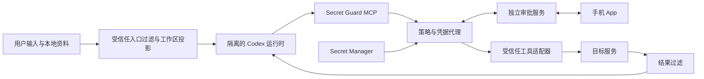

# Secret Guard for Codex：产品设计 v0.1

日期：2026-09-28。状态：产品设计提案；已提供第一阶段只读 GitHub MCP 兼容原型，严格版本尚未实现、验收或获得安全认证。原型的实际实现、默认值和测试边界见 [README](README.md) 与 [实现状态](docs/implementation.md)；其余文中默认值仍为设计建议。

## 1. 产品目标

让用户在 Codex 中完成需要密码/API Key 的工作，同时保留两项独立控制：允许当前任务引用凭据；允许某个工具为某次具体操作使用凭据。

产品承诺限定在已纳管的凭据、受保护项目和受支持的执行路径内：原始凭据不进入模型请求、会话记录、压缩摘要、工具调用参数、日志或遥测；批准只对用户看到的操作有效。不能承诺自动识别任意未知密码，也不能追回已发送到模型的秘密。

核心对象必须分开：

| 对象 | 含义 | 模型可见 |
|---|---|---|
| Secret | 密码或 token 的实际值及版本 | 否 |
| SecretRef | 当前任务内使用的随机不透明引用 | 第一阶段批准后可见 |
| ReferenceGrant | 当前用户允许本任务引用某凭据的记录 | 仅可见状态 |
| Invocation | 工具、目标、参数均已冻结的具体操作 | 可见安全摘要 |
| UseGrant | 用户批准这次操作的短时、单次许可 | 不交给模型；留在服务端 |

引用本身不赋予使用权限，第一阶段批准也不允许网络访问或获取明文。

## 2. Codex 接入决策

官方 MCP 支持本地 STDIO 和 Streamable HTTP；App Server 提供命令审批和 MCP elicitation。可借此展示状态、连接工具，但不能把普通 accept 回答当作独立的人类授权证明。[1][2]

Codex hooks 有 UserPromptSubmit、PreToolUse、PostToolUse 等入口。不过 hosted tools 不走本地工具 hook，write_stdin 不会重新触发 PreToolUse，一些专用路径还可绕过默认 hook。官方明确将其描述为 guardrail，而非完整强制边界。[3]

| 交付方式 | 可交付能力 | 保证范围 |
|---|---|---|
| 现有 Codex + MCP + 桌面伴随程序 | 凭据引用、手机审批、broker 执行、结果清洗 | 仅覆盖本产品工具；不能保护所有原生输入、附件和本地读取 |
| 受控 Codex 工作区 + 自有 App Server 客户端 | 接管输入入口，运行隔离的 Codex，提供清洗后的工作区 | 仍需验证内部工具输出进入模型与落盘的顺序 |
| 严格版本：受控运行时 + Codex 内核适配 | 在模型输入与持久化前统一过滤全部受支持的数据入口 | 需要维护 Codex 适配版本及完整回归测试 |

**建议路径：先以 MCP 兼容版验证审批和工具执行体验；完整产品承诺由严格版本实现。** 不把 MCP 兼容版宣传为“所有消息永不泄漏”。严格版使用自有客户端和受控 Codex 运行时；不假设能够修改或替换官方桌面应用内部逻辑。

不依赖监视 App Server 输出事件后再删除秘密：事件可能已经晚于模型消费或持久化。拦截必须在数据进入这些出口之前。

## 3. 用户体验

### 3.1 首次设置：建立受保护项目

用户在桌面伴随程序中选择项目、保护来源和允许的工具，然后配对手机。配对必须经桌面可信界面和手机双方确认，不能由 agent 自动注册审批设备。

凭据可由安全表单录入或连接已有 Secret Manager。发现本地 .env 等来源时，只在可信界面显示字段名、位置、类型、匹配置信度；不把扫描报告中的值发送给 Codex。

用户确认纳管后，构建一个给 Codex 使用的清洗工作区：受保护字段变成不可用占位符，其他代码保留。原文件不对 Codex worker 挂载；不自动改写或删除用户原文件。源目录和清洗副本之间的变更同步也必须经过检查。

git 历史、子模块、符号链接、构建产物、缓存、附件和进程环境都计入工作区准入范围。无法安全投影的来源直接阻止进入严格工作区，不能只清洗当前 .env 而放行含秘密的历史版本。

### 3.2 第一阶段：允许引用

场景：Codex 要读取项目配置；受控文件服务发现字段对应受保护的 GitHub 凭据。

1. 在原始内容成为消息之前暂停该数据项。
2. Codex 仅收到“此内容包含受保护字段，等待用户授权”的安全状态。
3. 手机展示系统生成的请求摘要。
4. 用户批准后，返回清洗内容，例如 `GITHUB_TOKEN=secretref://r_7k...`。
5. 拒绝或超时后返回 `[PROTECTED]`，不暴露引用，也不恢复原文。

手机卡片示例：

> 允许此任务引用凭据？
>
> 项目：payments-web · 任务：检查 GitHub 构建状态
> 凭据：GitHub / team-ci
> 来源：项目配置中的 GITHUB_TOKEN
> 授权内容：任务可以使用凭据引用；实际使用时仍需批准。
>
> [拒绝] [允许本任务引用]

建议 ReferenceGrant 在当前任务内有效，最长 8 小时；新任务、fork 或新子 agent 不自动继承。用户可提前撤销。关闭对话不等于撤销，UI 必须展示剩余有效期。

### 3.3 第二阶段：允许具体使用

Codex 通过具名工具提出操作，例如读取指定仓库的 workflow 状态。Broker 先解析参数、校验规则、冻结请求，然后发送手机审批。

> 允许使用 GitHub / team-ci？
>
> 操作：读取 acme/payments 的构建状态
> 接收方：api.github.com
> 工具：GitHub 构建查询
> 数据范围：最近 10 次构建
> 有效范围：本次操作；2 分钟内有效
>
> [查看完整请求] [拒绝] [仅允许这一次]

用户看到的业务摘要由受信任 adapter 从冻结参数生成，保留完整路径、query、必要请求体的可展开视图。Agent 提供的理由单独标记，不能替代实际操作内容。

批准后 broker 原子消费 UseGrant、解析凭据并执行。Codex 只收到清洗后的业务结果。若目标、参数、工具版本或凭据版本改变，原许可失效，必须重新审批。

第一阶段已有有效授权时只出现第二张卡；两类许可仍独立记录。第二阶段 MVP 不提供“本会话都允许”。

### 3.4 其他界面

桌面产品仅需四个主页面：受保护项目、凭据目录、待审批操作、活动记录。任务面板显示“等待引用授权 / 等待使用授权 / 执行中 / 完成 / 拒绝 / 结果待核实”。

手机 App 提供待审批列表、请求详情、设备管理和撤销。推送只显示有请求待处理；敏感项目名和完整参数进入已解锁的详情页。

邮箱作为通知入口，链接打开独立认证页面并要求设备密钥或 passkey 确认。邮件链接和 GET 请求不能完成批准；拥有邮箱访问权限的 agent 不能因此获得批准权。

## 4. 系统与信任边界



不信任：模型生成的参数和理由、项目代码、README/AGENTS.md、普通 shell 子进程、普通 MCP 服务、外部页面和返回内容。

信任：宿主入口过滤器、策略服务、审批设备、vault、受审核的 adapter、受控运行时及其 OS/隔离机制。不覆盖宿主 OS 被完全控制、用户审批设备被攻破或用户在产品外主动泄漏凭据。

严格版建议把 Codex worker 放在独立 VM/容器或等效安全域；broker 在另一个安全域。不能仅靠两个同用户进程、环境变量或一个 localhost 端口声称隔离。只读挂载受控配置，Codex 无权修改策略、hook、adapter 或批准端点。

Codex 不挂载宿主 HOME、钥匙串、浏览器 profile、SSH agent socket 或 Secret Manager 登录态。Agent 出网和 MCP 连接受控，不能通过备用 shell、任意网络代理或未批准工具绕过 broker。

模型服务登录凭据也必须留在受信任的宿主连接层，并验证所选 Codex 版本的认证路径；不能把包含宿主凭据的 HOME 一并复制进 worker。

## 5. 明文生命周期

1. 输入：安全输入框在调用 `turn/start` 前清洗。直接在官方应用中输入的原文不属于兼容版的保证范围。
2. 本地资料：先准入和投影，再允许 Codex 访问。扫描器精确匹配已登记值，结合格式和上下文规则识别候选秘密；未知候选隔离待确认。
3. 工具返回：buffer 后检查，再进入模型、会话、UI 事件或遥测。MVP 不流式放行可能包含秘密的输出；超限返回截断后的安全状态或拒绝。
4. 摘要和恢复：压缩、任务恢复、fork、子 agent 交接只读清洗历史；引用权限重新校验，不能从历史复制出新权限。
5. 多模态：MVP 严格模式不接入截图、OCR、音频和任意二进制附件，避免文本扫描器承诺无法覆盖的通道。

清洗器需要秘密匹配材料时运行在可信边界内，不将全量 vault 下发给 Codex 或 hook。错误消息、拒绝原因和命中上下文不得回显秘密。

“message 中无秘密”指进入模型和会话系统的数据。手机审批协议、vault 存储、broker 内存及发往合法目标服务的认证字段属于另一条受保护的数据通路。

## 6. 两种工具使用方式

| 模式 | 明文位置 | 产品策略 |
|---|---|---|
| 代理请求，默认 | Vault、broker、目标服务 | 工具只交引用和业务参数；broker 建立连接 |
| 隔离工具注入，后续版本 | 增加经过审核的独立工具进程 | 明确告知用户接收工具；绑定不可变程序及配置；限制出网和输出 |

MVP 不把真实 token 注入 Codex shell、任意 Python、用户可改写脚本或通用 HTTP 工具。普通工具拿到秘密后可以编码或拆分输出，因此响应脱敏不能替代执行隔离。

允许用户选择工具，不意味着允许任何工具读取全部秘密；只有注册且声明用途、目的地、版本和结果 schema 的适配器能够成为接收方。

## 7. MCP 与授权协议

以下是产品拟定义的工具，均不是现有 Codex 内置 API：

| 工具 | 行为 |
|---|---|
| `guard.request_reference(alias)` | 请求第一阶段授权；返回 pending 或会话内引用 |
| `guard.github_workflow_runs(ref, repo, limit)` | 创建冻结操作并请求第二阶段授权 |
| `guard.operation_status(operation_id)` | 读取安全状态和完成结果，不触发重执行 |

不提供 `get_secret`、`approve`、`export` 或向模型返回解密后的环境变量的工具。兼容版可用 elicitation 导航到审批页面，但页面打开和 Codex accept 本身都不构成授权。

工具申请经受信任连接绑定 user、device、task 和 agent identity；不能相信模型提交的 thread_id 或 project_id。无法获得可信逐任务身份时，启动每任务独立 MCP 连接/代理；不能默默退化到所有任务共享权限。

服务端冻结以下授权对象：

```text
principal + device + task + agent
secret_id + secret_version
adapter_id + adapter_digest + operation
scheme + host + port + path + query
canonical_args_digest + body_digest + relevant_headers_digest
policy_version + preview_digest
request_id + nonce + expires_at + max_uses=1
```

手机对包含用途域标识、随机 challenge 和上述摘要的审批请求进行签名；服务端验证注册设备与用户验证结果。审批记录留在 broker，不把可使用的签名票据交给模型。

执行端按同一规范序列化并比较，最后检查撤销与过期。默认禁重定向；校验目标解析、TLS 身份及出网范围；token 放置位置由 adapter 固定，不能由模型提供任意认证 header 或 credential 接收 URL。

状态机：`pending → approved → consumed → executing → succeeded / failed / unknown`；同时支持 `denied / expired / revoked`。并发请求必须原子消费。

超时、崩溃或网络断开可能意味着远端已经执行。此时标记 unknown，不能宣称跨系统 exactly-once，也不能自动恢复票据。优先使用服务端幂等键和查询接口；没有幂等能力的变更操作需要核实后再授权。

## 8. 策略设计

默认拒绝，规则先于审批：禁止的操作不能通过弹窗变成允许。Agent 可以提出新增规则建议，但不能修改规则。

建议初始策略：每个 secret 指定项目、工具适配器、允许资源、环境和操作；生产凭据与测试凭据分开；ReferenceGrant 最长 8 小时，UseGrant 最长 2 分钟、一次消费。拒绝后不自动循环重试，重复相同申请合并显示，防止审批轰炸。

撤销粒度包括设备、任务、凭据、某个待执行操作及全部权限。执行前撤销有效；已经开始的第三方请求尽力取消，但不能承诺撤销其已发生的外部副作用。

## 9. MVP 范围与交付顺序

目标用户：在本地 Codex 中使用团队 API 凭据的开发者。第一条闭环选择“读取 GitHub workflow 状态”，随后增加“创建指定仓库 issue”验证有副作用操作。

1. **协议闭环**：独立 broker、一个 vault adapter、手机授权、两个阶段、固定 GitHub adapter、结构化返回及审计。先以 MCP 兼容版接入现有 Codex。
2. **受保护运行环境**：清洗工作区、凭据和 worker 隔离、可信任务身份、受控出网；对假凭据完成绕过测试。
3. **严格消息保护**：自有 App Server 客户端和必要内核适配，覆盖输入、工具输出、持久化、压缩、恢复及子 agent；通过后才发布完整保证。
4. **扩大兼容**：更多 vault、adapter、跨平台与隔离工具注入。任何新工具或输入类型须重新通过边界验收。

不在 MVP 内：任意 shell 注入、浏览器自动填密、完整个人目录扫描接管、未知密码百分百识别、云端 Codex 与所有第三方 MCP 的透明保护。

不预设周期承诺；先完成 Codex 版本与入口覆盖性验证再估算。升级 Codex 时自动跑验收矩阵，未验证版本不得进入严格模式。

## 10. 验收标准

使用合成 canary 凭据和独立观察的目标服务测试，不使用真实用户密码。

| 测试 | 必须达到的结果 |
|---|---|
| 用户输入、文件和工具返回带 canary | 清洗前不落会话、日志、遥测或模型请求；拒绝不恢复原文 |
| shell 读取 HOME、凭据路径、原始仓库和进程环境 | 操作系统/隔离边界拒绝，不能仅靠模型回答“不能” |
| Agent 调用批准端点、构造 approved=true 或重放签名 | 无有效用户设备证明不能批准 |
| 批准后修改 repo、路径、请求体、工具或 secret 版本 | 执行拒绝并要求新的审批 |
| 同时消费、重复请求、跨任务复制引用 | 最多一个许可消费者；跨任务无权限 |
| 临时目标、重定向、DNS 变化及直接绕过网络代理 | 无未批准的认证请求抵达观察端 |
| 工具反射凭据、报错回显、分块或编码输出 | 支持路径中阻止泄漏；未覆盖路径禁用而非默认放行 |
| write_stdin、子 agent、压缩、恢复、fork | 不绕过边界、不继承未授权凭据使用权 |
| 服务离线、手机超时、策略不可读 | 不执行敏感操作；展示可恢复状态 |
| 调用已发出后 broker 崩溃 | 保留 unknown 与请求身份，不自动发起第二次副作用 |

另记录审批耗时、错误拦截率、每任务弹窗数、用户拒绝率、不可判定执行比例，以及 adapter 覆盖率。安全验收通过不代表对任意编码或未支持环境的数学保证。

## 11. 开发前需要验证的事项

- 本机观察到 `codex-cli 0.151.0`；官方在线文档可能领先于安装版本，hooks/elicitation/配置能力需逐项验证。
- 所选运行时内原始工具输出、流式事件、会话落盘及模型消费的真实顺序，决定严格版需要修改的位置。
- App Server 客户端与 MCP 通道怎样得到不可由模型伪造的任务绑定。
- 自有客户端使用的 Codex 登录方式、部署与分发条件，以及是否需要固定内核版本。
- Vault 选型、首发手机平台和现有桌面应用兼容要求。当前设计建议手机设备签名审批，邮箱仅通知；这些仍可评审。

## 12. 已核对的官方依据

以下来源证明现有集成能力；本文的 Secret Guard 架构、协议和产品界面属于设计建议。

1. [Codex MCP](https://learn.chatgpt.com/docs/extend/mcp?surface=cli)：STDIO、Streamable HTTP 及客户端配置。
2. [Codex App Server](https://learn.chatgpt.com/docs/app-server)：审批、MCP elicitation、任务接口。原生网络审批可按目标合并，因此不能替代具体操作授权。
3. [Codex Hooks](https://learn.chatgpt.com/docs/hooks)：工具 hook 覆盖面与例外，以及其非完整执行边界的定位。
4. [Codex Sandbox](https://learn.chatgpt.com/docs/sandboxing)：文件系统和网络隔离能力；仍需为本产品明确配置与验证读取边界。
